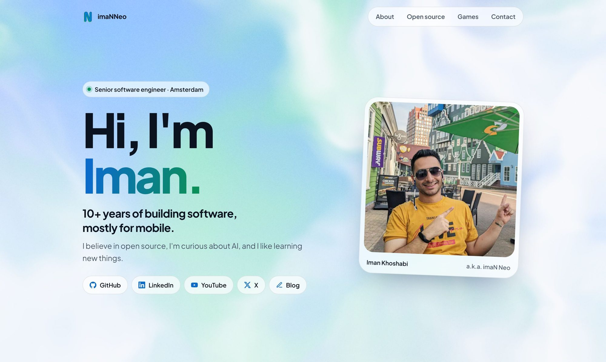

### My personal website

This is my personal website, made with [Hugo](https://gohugo.io/) and published at [imanneo.dev](https://imanneo.dev/).

It is a single page with its own small set of templates, so there is no theme to install or update.

<picture>
  <source media="(prefers-color-scheme: dark)" srcset="repo_files/screenshot-dark.jpg">
  
</picture>

#### Changing the content

Every text, link and list on the page lives in [`hugo.yaml`](hugo.yaml). Change it there and push to `main`: the site rebuilds and publishes itself.

| What | Where |
| --- | --- |
| Texts, links, and the lists of skills and games | `hugo.yaml` |
| Pictures | `static/images/` (the cover of a game is `static/images/games/<id>.webp`) |
| The page and the page for wrong addresses | `layouts/` |
| Colours and layout | `assets/css/main.css` |
| The moving background and the email button | `assets/js/main.js` |

The colours follow the device: light on a light device, dark on a dark one.

#### The fl_chart numbers

The stars, downloads and releases of fl_chart are asked from GitHub and pub.dev every time the site builds, and the workflow builds once a day, so they stay current. When GitHub or pub.dev does not answer, the numbers saved in `data/fl_chart.yaml` are shown instead.

#### The email address

The page never contains the email address as text, so that robots that collect addresses for spam do not find it. `hugo.yaml` holds it in two parts (`emailName` and `emailHost`), the build writes it into the page in an encoded form, and the button under "Say hi" puts it together in the visitor's browser when they press it.

#### Running it locally

Install the extended edition of Hugo, version 0.141 or newer (the workflow uses 0.144.2), and run:

```
hugo server
```

#### Credits

- The typeface is [Plus Jakarta Sans](https://github.com/tokotype/PlusJakartaSans) by Tokotype, under the SIL Open Font License (`static/fonts/OFL.txt`).
- The YouTube, GitHub, LinkedIn and X icons come from [Simple Icons](https://simpleicons.org/) (CC0), and the pen icon from [Feather](https://feathericons.com/) (MIT).
